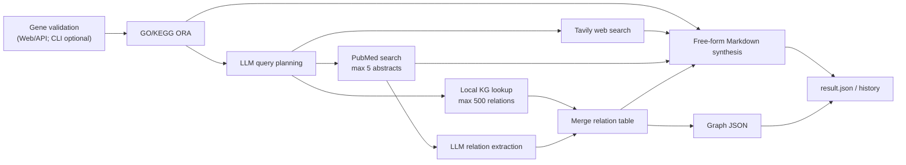
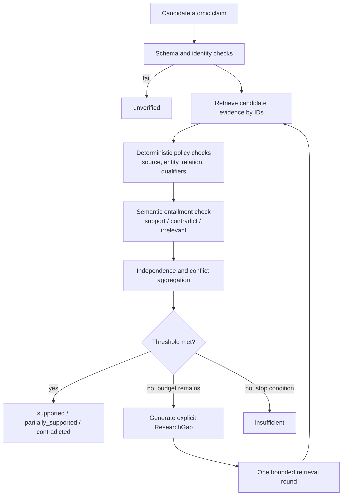
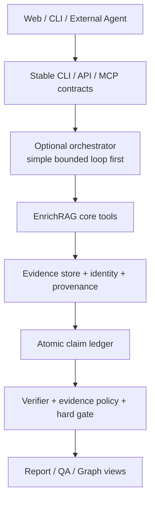

# EnrichRAG Agentic Evidence Roadmap

> 日期：2026-08-12  
> 狀態：current-state audit and implementation proposal  
> 範圍：evidence model、atomic claims、verification、agent tools、MCP、local LLM  
> 注意：本文件描述的 claim ledger、verifier、bounded retrieval 與 agent loop 尚未實作。

## 15 秒結論

EnrichRAG 現在是「固定 pipeline + LLM 敘事」，不是可驗證的研究 agent。正確順序不是先加 LangGraph 或把整條 pipeline 包成 MCP，而是：

1. 先讓每份證據有穩定身分、來源、版本與可引用片段。
2. 再把報告拆成 atomic claims，逐條驗證並 hard gate。
3. 最後才讓外部 AI、內建 agent 或本地模型自主決定要不要補查。

最重要的產品規則：**證據不夠不是生成失敗，而是一個必須被保存並呈現的正式結果。**

---

## 1. 本次盤點方法

本次不是只讀設計文件，而是交叉檢查：

- runtime：`pipeline.py`、`relation_extractor.py`、`query_planner.py`、KG normalizers、graph builder、chat context。
- interfaces：CLI、API/SSE、frontend result types。
- evaluation：`tests/test_pipeline_eval.py` 與既有 baseline。
- design docs：`autonomous-research-design.md`、`rag-advancement-and-agent-research.md`、`TODO.md`。
- 實際輸出：`output/result.json`，輸入為 12 個 DNA repair genes 與 `breast cancer` context。
- 外部設計依據：FActScore、SAFE、ALCE、Self-RAG、MCP、LangGraph、Ollama、vLLM 官方資料。

判讀標籤：

| 標籤 | 意義 |
|---|---|
| 已實作 | runtime 現在真的會做 |
| 已觀察 | 在現有 `result.json` 或 CLI 實際看到 |
| 建議 | roadmap 的設計選項，尚未實作 |
| 待決策 | 需要產品或科學政策拍板 |

---

## 2. 現況：它現在其實是什麼

### 已實作流程



### 已經具備的 agent substrate

| 能力 | 現有入口 | 可否直接變 tool | 目前限制 |
|---|---|---:|---|
| Gene validation/remap | `GeneValidationService`、CLI、API | 可以 | CLI result 沒保留 validation ledger |
| Gene profile | CLI、API | 可以 | 只有本地 NCBI-derived profile |
| GO/KEGG ORA | `GeneEnricher` | 可以 | 無 custom background、run provenance 不完整 |
| KG lookup | `KnowledgeGraph.lookup()` | 可以 | relation semantics 與 provenance 需先修 |
| PubMed search | `PubMedFetcher` | 可以 | 最多 5 篇、set 截斷造成選文不穩定 |
| Web search | `WebSearcher` | 可以 | snippet 不應直接等同科學證據 |
| Relation extraction | `RelationExtractor` | 可以 | 是 candidate extraction，不是 verification |
| Narrative synthesis | prompt + LLM | 不應直接當可信 tool | 會產生沒有 claim-level gate 的新敘述 |
| Result inspection | CLI `result ...` | 可以 | 尚無 claims、evidence、gaps、verification commands |

### 尚未實作

- 沒有 `EvidenceItem`、`AtomicClaim`、`VerificationResult` 或 `ResearchGap` runtime schema。
- 沒有 claim-evidence entailment、context matching、contradiction handling 或 hard gate。
- 沒有「補查後仍不足」的正式狀態與停止條件。
- 沒有 agent loop、MCP server 或可替換的 local-model agent interface。
- `SKILL.md` 目前只能教外部 agent 怎麼操作，不能保證 EnrichRAG 結果正確。

---

## 3. 實際 `result.json` 稽核

### 3.1 結果概況

| 指標 | 已觀察值 |
|---|---:|
| Input genes | 12 |
| GO terms | 94 |
| KEGG terms | 14 |
| Web sources | 13 |
| Retrieved PubMed abstracts | 5 |
| Relations | 520 |
| Graph nodes / edges | 398 / 846 |
| Explicit PMID citations in report | 2 |

Relation composition：

| Evidence source | Relations | 比例 | 說明 |
|---|---:|---:|---|
| Reactome | 172 | 33.1% | local KG |
| PubTator | 125 | 24.0% | local KG, linked PMID but no fetched metadata |
| STRING | 122 | 23.5% | local KG |
| KEGG | 63 | 12.1% | local KG |
| LLM extraction from retrieved abstracts | 38 | 7.3% | 5 abstracts |

**關鍵判讀：**若用舊設計的「最大單一 source 佔比 < 60%」衡量，這份結果會通過；但 92.7% relations 都來自 local KG，68.7% relations 沒有 PMID。這證明「資料庫數量多」不等於「獨立證據多樣」。

### 3.2 結果完整性問題

| 問題 | 已觀察證據 | 影響 | 優先級 |
|---|---|---|---|
| 非標準 JSON | 檔案內有 76 個 `NaN` token | Python 可讀，嚴格 JSON parser 可能失敗 | P0 |
| LLM relations provenance 空值 | 38 條的 `source_db`、`relation_group` 為 `NaN` | adapter 無法穩定分類與驗證 | P0 |
| PMID 格式不一致 | relation 為 `PMID:31456177`，source 為 `31456177` | `result inspect --gene BRCA1` 錯誤顯示沒有 linked papers | P0 |
| Run provenance 缺失 | 無 `schema_version`、model、prompt、DB build、retrieved_at | 不可重現、不可比較版本 | P0 |
| Validation ledger 缺失 | 此 CLI result 只有 normalized genes | 無法回看 accepted/remapped/rejected | P0 |
| KG evidence 細節遺失 | DB 有 `score`、`metadata_json`，lookup output 沒帶出 | STRING score、KEGG pathway、Reactome direction 無法驗證 | P0 |
| PubMed metadata 不完整 | relations 有 42 個 unique PMID，但 source list 只有 5 篇 | 37 個 PubTator PMID 無 title/abstract/study metadata | P1 |
| Entity 未正規化 | 98 個 relation endpoints 是未解析 `MESH:*` ID | graph 產生重複疾病/化學物節點 | P1 |

API SSE 會把非有限數字轉成 `null`，但 CLI `save_result()` 直接使用 Python 預設 `json.dump()`，所以同一個 analysis 經由 Web 與 CLI 可能有不同 JSON 行為。

### 3.3 Retrieval selection bias

已確認的偏差來源：

1. PubMed 最終只保留 5 篇 abstracts。
2. 多個 intent 的 PMID 先放進 `set`，再轉 list 截斷；沒有保留 relevance ranking，結果可能跨 run 變動。
3. Query planner 依 enrichment term 出現頻率只選 top 5 genes；這次是 `ATM, ATR, BRCA1, CHEK1, CHEK2`。
4. 報告未具名提到 `MLH1, MSH2, MSH6, PMS2, RAD52`，即使 mismatch repair 是第 3 名 KEGG term。
5. KG 每 source 以 score 排序，但不是 per-gene balancing；ATM 有 167 條 relations，RAD52 只有 7 條。Hub degree 會混入 database coverage bias。

這形成一個 feedback loop：

```text
高 annotation frequency
→ 被 planner 選為 top gene
→ 搜到更多 papers / KG edges
→ 報告更常提到
→ 看起來更「核心」
```

這個核心性可能是資料可見度，不是疾病機制。

### 3.4 Relation semantics 風險

下列是 code-confirmed 的 taxonomy 風險：

- STRING `combined_score` 被輸出成 `STRING protein-protein interaction`；但 STRING combined network 同時包含 physical interaction 與 functional association，不能一律解讀成 direct binding。
- KEGG `ubiquitination`、`glycosylation`、`dephosphorylation` 都被正規化成 `phosphorylation`，會改變生物學語意。
- KEGG `association` 被正規化成 `binding`，可能把較弱的關係升級成直接 binding。
- Reactome `activated by` 被正規化成 `activate`，但 source/target 沒有依方向反轉；原始 `direction` 只進 metadata，lookup 又把 metadata 丟掉。
- Reactome `expression regulated by` 被正規化成 `expression_down`，被動語態不代表 down-regulation。
- PubTator 的 disease/chemical entity 保留 MeSH ID，但沒有 label resolution。

在這些 semantics 修正前，agent 走更多 graph hop 只會更快放大錯誤。

### 3.5 報告 claim 的人工抽查

這不是正式 gold-label benchmark，而是用 proposed policy 對現有 report 做示範性 audit。

| 報告敘述 | 暫定狀態 | 理由 |
|---|---|---|
| 此 gene set 在 DNA repair GO terms 顯著 over-represented | supported | ORA 直接支持，但必須保留 library/background/p-adjusted qualifiers |
| Fanconi anemia、HR、MMR、p53 pathways 顯著 over-represented | supported | KEGG ORA 直接支持「over-representation」 |
| 這些 pathways 在 breast cancer 中被 disruption | insufficient | ORA 沒有量測 pathway state，沒有 disease-specific comparison |
| BRCA1/2、RAD51、ATM 暗示 impaired repair 導致 tumorigenesis | insufficient | 沒有樣本 variant/state、direction 或 causal study matching |
| BRCA1/2 與 RAD51 的 interaction 被現有 evidence 完整支持 | partially supported | 有 BRCA2-RAD51 KEGG/STRING edge，但本次 result 無 BRCA1-RAD51 direct edge |
| CHEK1/CHEK2 是 checkpoint players | partially supported | GO membership 支持功能脈絡，但 claim 沒有逐條 direct citation |
| PMID:33212010 支持 PTM 與 DNA damage response 關聯 | supported | abstract 直接提到 acetylation/PTM 與 DNA damage response |
| CHEK2-BRCA1 調控 p53、apoptosis 的 breast-cancer mechanism | insufficient hypothesis | graph overlap 可產生假說，但沒有 direct evidence chain |
| DNA repair 與 metabolism cross-talk | partially supported hypothesis | abstract 提到 acetylation/metabolism，但不是完整的 direct causal chain |

現況 prompt 有要求引用來源，也把 novel mechanisms 放在 hypothesis section；這是好方向。但 prompt 沒辦法阻止 `Interpretation` 新增無 citation 的 mechanistic claims，因此它不是 verifier。

### 3.6 Graph 該怎麼讀

現有 graph 可以回答：

- 哪些 input genes 分享 GO/KEGG term。
- local databases 記錄哪些一跳 relations。
- 哪些節點因資料庫收錄量或 query sampling 成為 hubs。
- 哪些 paper-extracted candidate relations 值得回頭看 abstract。

現有 graph **不能**直接回答：

- 哪個 pathway 在此 disease/sample 中 activated 或 inhibited。
- 哪個 gene 是 causal driver。
- 哪個 edge 是 direct physical binding。
- 哪條 graph path 是已驗證 mechanism。
- 哪個 drug 會對病人有效。

因此 UI 上的「hub」應解讀成 **retrieved graph hub**，不是 biological master regulator。

---

## 4. 生物科學家的最大批判

### 4.1 輸入的科學語意沒有被建模

同一串 genes 可能代表：

- manually selected pathway genes；
- differential expression genes；
- somatic variants；
- germline panel；
- CRISPR hits；
- protein abundance changes。

這些輸入需要不同的 background、方向、effect size 與 evidence policy。現在只保存 symbols + disease string，後續卻生成 mechanism 與 therapeutic interpretation。

對本次 12 個 genes 而言，它們本來就是人工挑選的 DNA repair/MMR genes。得到 DNA repair enrichment 是合理 sanity check，但接近 selection tautology，不能當成 breast-cancer-specific discovery。

### 4.2 ORA 只證明 over-representation

目前 `GeneEnricher`：

- 使用 `GO_Biological_Process_2021` 與 `KEGG_2021_Human`。
- 沒有接受 assay-specific background universe。
- 沒有 expression direction、effect size、sample group 或 tissue state。

所以 ORA 可以支持：

> 在指定 library 與 background 下，輸入 genes 對 term X 的 overlap 高於隨機預期。

但不能支持：

> Pathway X 在 breast cancer 中被 activated、dysregulated、causal，或可被治療性 targeting。

如果 genes 來自 targeted panel，拿全基因組當 background 甚至可能讓 p-value 失去正確 denominator。

### 4.3 異質證據被壓成同一種 edge

STRING functional association、KEGG pathway relation、Reactome FI、PubTator text-mined relation、LLM abstract extraction 與 web snippet 的證據生成方式不同。現在它們被合併進同一 relation table 與 graph，再交給 LLM 敘事。

真正缺少的不是更多 edges，而是：

- evidence class；
- exact source record；
- study/context qualifiers；
- direction與relation semantics；
- source independence；
- claim-specific admissibility policy。

### 4.4 Abstract 不是完整實驗證據

Abstract 常缺少 cohort definition、control、effect size、negative results、assay details 與 limitation。它適合 discovery 與初步 support，不適合單獨支撐 clinical recommendation 或複雜 causal mechanism。

### 4.5 現有 evaluation 獎勵「寫出預期答案」

`test_pipeline_eval.py` 的 judge 問的是：report 是否支持預先寫好的 expected claim。它沒有問：

- report 自己產生了哪些 atomic claims；
- cited evidence 是否真的 entail 每條 claim；
- context/species/direction 是否匹配；
- unsupported claim 是否正確 abstain。

既有 baseline 為 5 cases 中 2 passed、3 failed；這仍可保留作 **coverage evaluation**，但不能代表 scientific faithfulness。

---

## 5. 對既有設計文件的修正

### 應保留

- Claim-based report 是後續 metrics、chat 補查與 agent gap detection 的前提。
- Pipeline snapshot 與後續 enriched view 分開，避免補查覆寫原始結果。
- 每個 question 的補查應有 budget，補完仍不夠就明確 abstain。
- MCP 與 LangGraph 是 interface/orchestration，不是 evidence correctness。

### 應修改

| 舊設計 | 問題 | 建議修正 |
|---|---|---|
| `claims_with_sources / total_claims` 稱 faithfulness | 有 citation 不代表 citation 支持 claim | 改名 citation coverage；faithfulness 需 entailment audit |
| Citation density 目標 `>= 1.5` | 容易鼓勵 citation stuffing | 評估 sufficiency、entailment、independence，不追求固定數量 |
| Claim specificity 越高越好 | 可能鼓勵加入未支持的 entity/mechanism | specificity 只當描述性指標，不能當 truth metric |
| Baseline metrics 不 block report | 與已接受的 hard gate 衝突 | 結構 metrics 不 block；claim verification 必須 block main conclusion |
| LLM 判斷「能否回答」 | LLM 可能高估 evidence | LLM 提議 gap；policy engine 決定是否達標 |
| 先 MCP、再 verifier | 會把不穩定語意包成更多 agent 可用工具 | evidence core/verifier 先，MCP 後 |
| `KG > PubMed extraction > Tavily` 固定排序 | evidence quality 取決於 claim type | 改為 claim-type-specific policy |

### 應刪除或降級

- 不應顯示無法校準的單一 `confidence: 0.87` 當 truth。
- 不應把 agent 的 hidden chain-of-thought stream 給使用者；只顯示可稽核事件，例如 query、tool、evidence count、status change、stop reason。
- 不應讓一個 generic `analyze` tool 的 free-form report 成為其他 agents 的事實來源。

---

## 6. 目標資料契約

### 6.1 `EvidenceItem`

```json
{
  "evidence_id": "ev_pubmed_33212010_sent_04",
  "source_kind": "pubmed_abstract",
  "source_db": "pubmed",
  "source_version": null,
  "citation": {"pmid": "33212010", "doi": null, "url": null},
  "record_id": "PMID:33212010",
  "title": "Proteogenomic Landscape of Breast Cancer...",
  "excerpt": "Acetylproteome analysis highlighted...",
  "location": {"section": "abstract", "sentence_index": 4},
  "entities": ["DNA damage response", "acetylation"],
  "relation": "associate",
  "qualifiers": {
    "species": "human",
    "disease": "breast cancer",
    "study_type": "proteogenomic cohort"
  },
  "retrieval": {
    "query_id": "query_04",
    "retrieved_at": "2026-08-12T00:00:00Z"
  }
}
```

必要規則：

- `evidence_id` 必須 deterministic，可跨 rerun deduplicate。
- Evidence 保存原文片段與位置，不只保存 LLM paraphrase。
- KG evidence 要保留 score、raw relation、pathway/record ID、source build/version。
- Web result 預設是 discovery lead；只有解析到可追溯 primary/official source 後才升級為 support evidence。

### 6.2 `AtomicClaim`

```json
{
  "claim_id": "clm_001",
  "claim_type": "database_relation",
  "mode": "finding",
  "subject": {"id": "HGNC:1101", "label": "BRCA2"},
  "predicate": "activates",
  "object": {"id": "HGNC:9817", "label": "RAD51"},
  "qualifiers": {
    "pathway": "Fanconi anemia pathway",
    "disease": null,
    "species": "human"
  },
  "text": "KEGG records BRCA2 activating RAD51 in the Fanconi anemia pathway.",
  "candidate_evidence_ids": ["ev_kegg_hsa03460_017"],
  "generated_by": {"method": "deterministic_adapter", "version": "1"}
}
```

Atomic 的最低標準：

- 一個 subject-predicate-object 核心。
- 一組不能拆開的 qualifiers。
- 不把 association、mechanism、causality、clinical implication 塞在同一句。
- Hypothesis 必須是 `mode: hypothesis`，不能因為 graph path 存在就變 finding。

錯誤例子：

> BRCA1/2 與 RAD51 repair DNA，造成 breast cancer，並預測 PARP inhibitor sensitivity。

至少應拆成：interaction、repair function、disease causality、drug response 四條 claims，分別套不同 evidence policy。

### 6.3 `VerificationResult`

```json
{
  "claim_id": "clm_001",
  "status": "supported",
  "policy_id": "database_relation_v1",
  "supporting_evidence_ids": ["ev_kegg_hsa03460_017"],
  "contradicting_evidence_ids": [],
  "reason_codes": ["EXACT_ENTITY_MATCH", "RELATION_MATCH", "CONTEXT_MATCH"],
  "missing_requirements": [],
  "attempts": 1,
  "verified_by": {
    "deterministic_rules": "1.0",
    "semantic_judge": null
  }
}
```

### 6.4 Status 語意

| Status | 精確定義 | 報告位置 |
|---|---|---|
| `supported` | evidence 達到該 claim type 的 policy | Main findings |
| `partially_supported` | 核心有支持，但 qualifier、direction、population 或部分子命題缺失 | Tentative findings + caveat |
| `contradicted` | 有直接反向 evidence，且目前無足夠 support 解決衝突 | Conflicting evidence |
| `insufficient` | verifier 已執行，且在 budget 內仍未達 evidence threshold | Evidence gaps |
| `unverified` | verifier 未執行、tool failure、schema invalid 或 evidence 無法讀取 | 不得進結論 |

`insufficient` 與 `unverified` 不可混用。前者是研究結果；後者是系統執行狀態。

如果同時有強支持與強反證，MVP 可用 `partially_supported + has_conflict=true`；後續再考慮獨立 `conflicted` status。

---

## 7. Evidence policy matrix

### 建議 MVP policy

| Claim type | 可單獨 support 的最低 evidence | 不能推出 |
|---|---|---|
| ORA result | 完整 ORA record + library/version + background + p-adjusted | activation、disease causality、treatment |
| Database assertion | 一條可追溯 KG record | 不加「資料庫記錄」限定的生物事實 |
| Functional association | STRING/Reactome exact edge + source semantics | direct binding、direction、disease context |
| Directed regulation | directed curated record，方向與 context 都保留 | organism/disease 外推、causality |
| Literature association | 一段 direct sentence + PMID + entity/context match | mechanism、causality |
| Mechanistic claim | direct experimental evidence，且 model/intervention/readout 匹配 | human clinical outcome |
| Causal disease claim | 多個直接、獨立且 context-matched studies；需明示 study limits | 個人風險與臨床建議 |
| Biomarker/predictive claim | 有 outcome definition、cohort、effect estimate、validation | clinical utility |
| Therapeutic/clinical claim | trial/guideline/primary clinical evidence，population/intervention/outcome 匹配 | universal treatment recommendation |
| Hypothesis | 可由 graph/enrichment/literature gap 產生 | `supported finding` 標籤 |

### Local KG 單獨能不能讓 claim 通過

**推薦的嚴格答案：可以，但只讓「database assertion」通過。**

```text
可 supported：
「KEGG 在 Fanconi anemia pathway 中記錄 BRCA2 activates RAD51。」

最多 partial：
「BRCA2 activates RAD51。」

insufficient：
「BRCA2 經由 RAD51 造成 breast cancer。」
「這個關係預測 PARP inhibitor response。」
```

原因：KG edge 能證明資料庫收錄了某關係，不自動證明該關係在指定 disease、cell type、variant、patient population 中成立。

此 policy 尚需正式拍板；在拍板前，不應讓 local KG 自動支撐 disease/therapeutic main conclusions。

---

## 8. Verifier 應怎麼運作



### Layer 1：Deterministic checks

- Evidence ID 存在且可讀。
- Claim entities 與 evidence entities 相符。
- Relation type 沒有被升級，例如 `associate` 不能 support `cause`。
- Direction 沒有反轉。
- Species、disease、tissue、population、intervention、outcome qualifiers 相符。
- Citation 指向的 record 與 excerpt 一致。
- Source version 與 retrieval metadata 完整。

### Layer 2：Semantic judge

LLM/NLI 只判斷：

- evidence 是否直接支持 claim；
- 是否只支持部分 qualifiers；
- 是否反駁；
- 是否無關。

Judge 必須回傳 structured labels + reason codes + quoted evidence span。它可以協助語意判讀，但不能自行降低 policy threshold。

### Layer 3：Aggregation

- 同一 paper 被 KG、PubTator、abstract extraction 重複引用，只算一個 underlying source。
- 多個 database edge 可能共享同一 upstream source，不自動視為獨立 replication。
- 支持與反證要同時保留，不用多數決把 conflict 隱藏。

### Stop policy

建議 MVP 每個 research question 最多 1 個 supplement round；系統成熟後可提高到 2 rounds。任何條件成立即停止：

- 相同 normalized query 已執行。
- 沒有新增 unique evidence。
- verification status 沒改善。
- paper/query/token/cost/time budget 到頂。
- tool error 使 verification 無法繼續，狀態改為 `unverified`，不是 `insufficient`。

### Hard gate

```text
supported             → Main findings
partially_supported   → Tentative findings，必附 caveat
contradicted          → Conflicting evidence
insufficient          → Evidence gaps，直接說證據不足
unverified            → 不得發布為結論
```

敘事 report 必須從 verified claim ledger render。若再用 LLM 把 claims 改寫成 prose，改寫後產生的新 atomic claims 必須再驗一次，否則 narrative 會重新引入 hallucination。

---

## 9. Tool-first architecture

### 9.1 建議 core tools

| Tool | 類型 | 輸出契約 | 誰有最終決定權 |
|---|---|---|---|
| `validate_genes` | deterministic | validation ledger | core |
| `enrich_genes` | deterministic/statistical | ORA evidence items | core |
| `query_kg` | deterministic retrieval | KG evidence items | core |
| `search_pubmed` | retrieval | ranked paper candidates + query log | core |
| `fetch_paper` | retrieval | abstract/full-text evidence spans | core |
| `search_web` | retrieval | discovery leads | core |
| `extract_relations` | generative candidate extraction | candidate evidence mappings | verifier |
| `propose_claims` | deterministic + generative | atomic claims | verifier |
| `verify_claims` | policy + semantic judge | verification results | policy engine |
| `identify_gaps` | policy + optional LLM | ResearchGap records | policy engine |
| `render_report` | deterministic first | claim-based report | verified ledger |

關鍵原則：agent 可以決定 **何時呼叫 tool**；不能決定 **什麼 evidence threshold 算通過**。

### 9.2 建議分層



Correctness boundary 在 `Evidence store → Claim ledger → Verifier`，不是在 skill、MCP client 或特定 LLM provider。

### 9.3 四條 agent 路徑

| 路徑 | 做法 | 優點 | 風險 | 建議時機 |
|---|---|---|---|---|
| External AI + CLI/API | Codex/Claude 等依 skill 呼叫 tools | 最快驗證研究 workflow | agent 行為不完全受控 | tool contracts 穩定後即可 |
| External AI + MCP | 將同一 tools 暴露為 MCP | 標準 discovery/call interface | MCP 不提供 correctness | verifier 完成後 |
| Built-in bounded agent | app 內實作 gap → retrieve → verify loop | UX 與 budget 可控 | 需要 state、trace、error handling | claim/verifier 後 |
| Local LLM | Ollama/vLLM tool calling | 隱私、離線、成本可控 | tool selection/entailment 品質需 benchmark | 最後替換 model adapter |

Ollama 官方已支援 single、parallel、multi-turn tool calling。vLLM 支援 named/required/auto tool choice 與 schema constraints，但官方也明確區分「可解析 function call」和「高品質 function call」。因此 local model 可接同一套 tools，但不能跳過 verifier benchmark。

### 9.4 推薦 hybrid

- Deterministic Python：validation、ORA、retrieval normalization、identity、policy gate、budget、stop。
- 小型 local model：query reformulation、candidate claim decomposition、低成本 triage。
- 強模型：困難的 biomedical entailment，且輸出仍受 schema/policy 限制。
- Human review：clinical、causal、high-impact contradictory claims。

這讓模型可替換，而 evidence contract 不變。

### 9.5 Skill 要怎麼改

Skill 應在 tools 穩定後描述操作順序：

```text
validate
→ inspect remaps/rejections
→ enrich with explicit input semantics/background
→ inspect terms and evidence classes
→ propose atomic claims
→ verify
→ retrieve once for explicit gaps
→ verify again
→ render supported/partial/conflict/insufficient sections
→ stop
```

Skill 必須寫清楚：

- 不把 ORA 解讀成 activation/causality。
- 不把 STRING edge 解讀成 direct binding。
- 不讓 `unverified` claim 進結論。
- evidence 不足時停止，不自行補成「一般常識」。
- CLI、API、MCP 只是同一 core contract 的不同 transport。

Skill 不應保存 evidence policy 本身；否則 Web runtime、本地 agent 與外部 agent 會有不同真相標準。

### 9.6 何時才需要 LangGraph

先用普通 Python state machine 實作一輪 bounded retrieval，因為較容易測試與 debug。只有出現下列需求再引入 LangGraph：

- long-running research 可中斷與 resume；
- durable checkpoint；
- human approval/edit；
- 跨多輪 persistence；
- 複雜分支與 parallel workers；
- 需要重播完整 state transitions。

LangGraph 提供 orchestration、persistence、interrupts，不替代 evidence policy。

---

## 10. 對現有構造的影響

### Backend result schema

建議 `AnalysisResultV2`：

```text
schema_version
run_metadata
input_context
gene_validation
enrichment_results          # backward compatible
sources                     # backward compatible
gene_relations              # backward compatible candidate view
evidence_items              # new
claims                      # new
verifications               # new
research_gaps               # new
quality_metrics             # new
graph_views                 # snapshot / enriched / claim graph
llm_insight                 # backward-compatible rendered view
```

### Pipeline

固定 analysis 仍可保留，但 synthesis 後移：

```text
validate → enrich/retrieve → normalize evidence → propose claims
→ verify → optional bounded retrieval → render report
```

不要把整個 `pipeline.py` 直接改寫成 agent。先把每個步驟抽成有 typed input/output 的 service function，pipeline 與 agent 都呼叫同一層。

### API / SSE

新增可稽核事件，不 stream hidden reasoning：

- `evidence_normalized`
- `claims_proposed`
- `claims_verified`
- `research_gap_created`
- `supplement_search_started`
- `verification_updated`
- `research_stopped` + reason code

### Frontend

最低需要：

- Claim cards：status、claim type、qualifiers、evidence count。
- Evidence drawer：原文片段、PMID/DB record、source version、support/contradict reason。
- Report sections：supported、tentative、conflict、insufficient。
- Graph views：raw evidence graph 與 verified claim graph 分開。
- Hub label 改成 retrieved degree，避免 biological centrality 誤讀。

### CLI

在現有 `result summary/papers/terms/graph-stats/inspect` 之外，建議增加：

```bash
enrichrag result evidence output/result.json
enrichrag result claims output/result.json
enrichrag result claim output/result.json --id clm_001
enrichrag result gaps output/result.json
enrichrag result verify output/result.json
```

### History compatibility

- 舊 history 繼續以 V1 顯示，不嘗試猜測回填 verifications。
- V2 必須有 `schema_version`。
- Migration 只做欄位包裝，不把舊 free-form prose 自動標成 supported。

---

## 11. 實作 roadmap

### Phase 0：結果完整性與 semantics

目標：先讓目前 pipeline 的輸出可被嚴格消費。

- Emit strict JSON，不允許 `NaN/Infinity`。
- 統一 PMID canonical ID。
- LLM extraction 補 `source_db=pubmed_llm` 與 relation group。
- KG lookup 保留 score、raw relation、metadata、source version/build。
- 修正 STRING label、KEGG PTM conflation、Reactome direction semantics。
- PubMed 保留 per-query ranking，做 deterministic merge，不用 unordered set 截斷。
- 將 validation、run/model/prompt/library/database metadata 寫進 result。

驗收：strict parser 可讀；相同 fixture 產生穩定 evidence IDs；任何 relation 都能回到 source record；taxonomy adversarial tests 通過。

### Phase 1：Evidence substrate

目標：所有來源轉成同一 `EvidenceItem` contract，但不改 report UI。

- Pydantic schemas + `schema_version`。
- GO/KEGG、STRING、Reactome、PubTator、PubMed、Web adapters。
- Entity IDs 與 MeSH label resolution。
- Evidence dedup 與 underlying-source identity。
- Evidence store 可先放 result JSON，不急著新建資料庫。

驗收：每個 evidence item 有 stable ID、source、record、excerpt/metadata、retrieval provenance；無 orphan citation。

### Phase 2：Atomic claim ledger

目標：先產生少數可安全驗證的 claim types。

- Deterministic ORA claims。
- Qualified database assertions。
- LLM 只產生 literature candidate claims，強制 structured output。
- Compound claim decomposition。
- MVP 暫停自動生成 clinical/therapeutic conclusions；只能產生 hypothesis/gap。

驗收：每條 claim 只有一個核心 predicate；所有 evidence references 可解析；相同 evidence fixture 產生穩定 claims。

### Phase 3：Verifier + hard gate

目標：系統第一次真正能說「證據不足」。

- Claim-type policy registry。
- Deterministic entity/relation/direction/context checks。
- Structured semantic entailment judge。
- `supported/partially_supported/contradicted/insufficient/unverified`。
- Claim-level reason codes 與 audit log。

必做 adversarial tests：

- STRING edge 不得 support direct binding 或 causality。
- ORA 不得 support pathway activation。
- Association 不得 support treatment response。
- Wrong species/tissue/population 不得完整 support。
- Citation 存在但不 entail claim 必須 fail。
- Multi-clause claim 必須拆分或 fail。
- Tool failure 必須是 `unverified`，不是 `insufficient`。

驗收：unsupported claim 無法進 main findings；每個 status 可由 evidence + reason codes 重現。

### Phase 4：Claim-based report、CLI、UI

目標：使用者可以自己稽核結論。

- Deterministic report renderer first。
- Claim/evidence/gap CLI commands。
- Claim cards + evidence drawer。
- Snapshot/evidence/verified-claim graph views。
- 保留 `llm_insight` 作 backward-compatible rendering，不作 source of truth。

驗收：點每條 main claim 都能看到 direct support；insufficient claims 集中在 evidence gaps。

### Phase 5：Evidence-grounded evaluation

目標：不再只測「有沒有寫到預期知識」。

- 保留現有 5-case content coverage baseline。
- 建立 50-100 條 expert-labeled claims 的小型 gold set。
- 指標：claim support precision、abstention precision/recall、citation entailment、citation completeness、status confusion matrix、retrieval recall、run reproducibility。
- 加入 plausible-but-invalid adversarial cases，而不只 happy path。

驗收：在導入 agent retrieval 前，先有可比較的 verifier baseline；不得只報 overall accuracy。

### Phase 6：Bounded adaptive retrieval

目標：只對明確 ResearchGap 補查。

- Gap schema：缺 entity、relation、context、study type 或 contradiction resolution。
- 每 question 最多一輪，之後視 benchmark 增為兩輪。
- Query/paper/token/time/cost budgets。
- No-new-evidence、repeated-query、no-status-improvement stop rules。
- 補查 evidence 寫入 enriched view，不改 snapshot。

驗收：一個可補足 case 會升級 status；一個無法補足 case 會穩定輸出 `insufficient` 並停止。

### Phase 7：API/MCP/Skill

目標：讓 Codex、Claude 或其他 clients 安全使用同一 tools。

- 先發 atomic read/research tools，再保留高階 `analyze` convenience tool。
- MCP 只包 stable service layer，不直接包 UI route。
- Repo skill 記錄 safe workflow、禁止推論與 inspection commands。
- Tool descriptions 說清楚「能證明什麼／不能證明什麼」。

驗收：CLI、API、MCP 對相同 fixture 回傳同 schema/status；外部 agent 無法繞過 hard gate 把 unverified claim 標為 supported。

### Phase 8：Local/hybrid model 與 LangGraph

目標：替換 agent brain，而不改 correctness core。

- Model adapter：OpenAI-compatible、Ollama、vLLM。
- 用同一 gold set benchmark decomposition、tool selection、entailment、abstention。
- 低品質 local model 只做 candidate generation，不做 final verifier。
- 需要 durable resume/HITL 後再導入 LangGraph。

驗收：切換模型不改 evidence IDs、policy result 與 report gate；模型差異只反映在 candidate/retrieval quality。

---

## 12. 建議 PR 切法

每個 PR 只處理一個可驗證行為：

| PR | 建議 conventional commit | 完成條件 |
|---|---|---|
| 1 | `fix(result): emit strict provenance-safe json` | 無 NaN、PMID 可 join、run metadata 完整 |
| 2 | `fix(kg): preserve relation semantics and provenance` | raw relation/direction/score/version 可回溯 |
| 3 | `feat(evidence): add normalized evidence contracts` | adapters + stable IDs + tests |
| 4 | `feat(claims): generate atomic research claims` | ORA/database/literature candidate claims |
| 5 | `feat(verifier): gate claims by evidence policy` | statuses + reason codes + adversarial tests |
| 6 | `feat(report): render verified claim ledger` | CLI/UI 可稽核 claims/evidence/gaps |
| 7 | `test(evaluation): add claim support benchmark` | support/abstention/citation metrics |
| 8 | `feat(research): add bounded evidence retrieval` | one-round loop + stop reasons |
| 9 | `feat(mcp): expose verified research tools` | external agent interoperability |

第一個實作 slice 應是 PR 1，不是 LangGraph，也不是 MCP。

---

## 13. 你接下來可能會問的 Q&A

### Q1：所以真的就是先做 tools，再做 agent tool use？

是，但更精確是先做 **evidence contracts + verifier-backed tools**。只有把現有 Python functions 包成 tools，會把現有 ambiguity 原封不動暴露給 agent。

### Q2：現在能不能直接讓 Codex 用 CLI 做完整研究？

可以做 validation、analysis、term/paper/graph inspection，並由 Codex 人工判讀；不能把現有 `llm_insight` 當已驗證答案。現階段是 human/agent-assisted audit，不是 verifier-backed autonomous research。

### Q3：Skill 要先改嗎？

可以先補「安全操作順序」作暫時 guardrail，但不要把它當 correctness。正式 skill 應等 claim/evidence/status commands 穩定後再定稿。

### Q4：MCP 要先做嗎？

不建議。MCP 只是讓模型發現與呼叫 tools；它不會修 relation semantics、不會判斷 citation entailment，也不會替你說 evidence insufficient。

### Q5：Local KG 一條 edge 到底能不能 supported？

推薦只 support qualified database assertion，例如「STRING records a functional association between A and B」。拿掉 source qualifier 的 biological claim 最多 partial；causal/clinical claim 必須 insufficient。

### Q6：為什麼不能只在 prompt 寫「沒證據就說不知道」？

因為同一個 prompt 同時被要求 interpret、connect mechanisms、propose novelty。沒有逐 claim gate 時，模型不知道哪一句跨過 evidence boundary，系統也無法阻止它輸出。

### Q7：Atomic claim 是不是把每句切短就好？

不是。Atomic 的重點是每條只有一個可判定的核心 relation 與 qualifiers。短句仍可能同時包含 association、causality、therapy 三個主張。

### Q8：有 source 就算 supported 嗎？

不算。必須檢查該 source 是否直接 entail claim、方向正確、entity/context 匹配，且 evidence class 達到 claim type threshold。

### Q9：引用越多越可信嗎？

不一定。五個資料庫引用同一篇 paper 不等於五個獨立證據；很多 irrelevant citations 反而是 citation stuffing。

### Q10：證據不足要怎麼確定不是系統沒查好？

結果必須附 retrieval coverage 與 stop reason。`insufficient` 表示在明確 budget/query strategy 下查過但未達 threshold；tool 失敗或未執行則是 `unverified`。

### Q11：Graph 可以拿來找 novel mechanism 嗎？

可以產生 hypothesis candidate，例如 A-B-C path；不能直接升級為 finding。每一 hop 的 semantics、方向、context 與 independence 都要驗證。

### Q12：目前這份 BRCA 結果有科學價值嗎？

有，適合做 pathway sanity check、evidence navigation 與 hypothesis generation。它不適合直接支持 breast-cancer mechanism、causal variant interpretation 或 therapeutic recommendation。

### Q13：為什麼 DNA repair enrichment 這麼顯著還不能說重要？

因為輸入本來就是 DNA repair genes。它證明工具找到預期 annotation，不證明這組 genes 是由 breast cancer data 無偏地發現，也不證明 pathway activity。

### Q14：本地 AI 能不能做到？

能。Ollama/vLLM 都可讓模型呼叫 function tools；但 tool-call schema 正確不等於 biomedical judgment 正確。先用 gold set 決定 local model 可負責 candidate generation、query planning，還是足以做 semantic judge。

### Q15：是否一定要 LangGraph？

不一定。MVP 一輪 bounded retrieval 用普通 Python state machine 更容易測試。需要 durable checkpoint、resume、HITL 與複雜 branching 時再上 LangGraph。

### Q16：最小可行產品是什麼？

不是「會自己查更多 paper」。MVP 是：每條 ORA/database/literature claim 都有 evidence ID 與 verification status，unsupported claim 不進 main report，系統能穩定輸出 evidence insufficient。

### Q17：最大的技術風險是什麼？

不是模型不夠聰明，而是 evidence semantics 錯誤卻被穩定地自動化。錯方向 edge、錯 background、錯 citation join 一旦進 agent loop，會變成可重複且有說服力的錯誤。

### Q18：最大的產品槓桿是什麼？

把 verified claim ledger 做成唯一 source of truth。Web report、chat、CLI、MCP、local AI、export 與 evaluation 都能共用，不必各自重做 grounding。

---

## 14. 待拍板決策

已對齊：

- `unverified` 不得進 main conclusion。
- `insufficient` 必須明確說證據不足。
- agent 不得用更多 prose 掩蓋 evidence gap。

仍需正式拍板：

1. Local KG 是否採本報告建議的嚴格 policy：只單獨 support qualified database assertion。
2. MVP claim scope 是否只做 ORA、database assertion、literature association，先排除 clinical/therapeutic findings。
3. 初版 supplement budget 是否固定每 question 一輪。
4. 是否要求使用者提供 input semantics 與 background universe，否則 ORA claim 自動帶 limitation。

推薦答案全部是「是」。這會犧牲第一版的華麗感，但建立可被科學家信任的底座。

---

## 15. 外部參考

- [FActScore: atomic fact decomposition and support evaluation](https://aclanthology.org/2023.emnlp-main.741/)
- [SAFE: search-augmented long-form factuality evaluation](https://arxiv.org/abs/2403.18802)
- [ALCE: citation correctness and citation quality evaluation](https://arxiv.org/abs/2305.14627)
- [Self-RAG: adaptive retrieval and self-reflection](https://arxiv.org/abs/2310.11511)
- [STRING 2023: physical interactions and functional associations](https://pmc.ncbi.nlm.nih.gov/articles/PMC9825434/)
- [MCP server primitives and control boundaries](https://modelcontextprotocol.io/specification/2025-06-18/server/index)
- [MCP tools and human-in-the-loop guidance](https://modelcontextprotocol.io/specification/2025-06-18/server/tools)
- [LangGraph reference](https://langchain-ai.github.io/langgraph/reference/)
- [Ollama tool calling](https://docs.ollama.com/capabilities/tool-calling)
- [vLLM tool calling](https://docs.vllm.ai/en/latest/features/tool_calling/)

## 16. Repository evidence pointers

- Pipeline synthesis/result assembly：`enrichrag/core/pipeline.py`
- Free-form report prompt：`enrichrag/prompts/templates/enrichment_analysis.yaml`
- Relation candidate extraction：`enrichrag/core/relation_extractor.py`
- Query selection：`enrichrag/core/query_planner.py`
- PubMed cap/merge：`enrichrag/core/pubmed.py`
- ORA defaults：`enrichrag/core/enricher.py`
- KG query projection：`enrichrag/knowledge_graph/knowledge_graph.py`
- Relation semantics：`enrichrag/knowledge_graph/relation_taxonomy.py`
- Source normalizers：`enrichrag/knowledge_graph/*_normalizer.py`
- Current content evaluation：`tests/test_pipeline_eval.py`
- Frontend result contract：`frontend/src/types.ts`
- Existing proposals：`docs/autonomous-research-design.md`、`docs/rag-advancement-and-agent-research.md`
